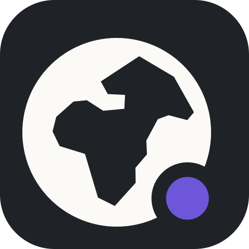
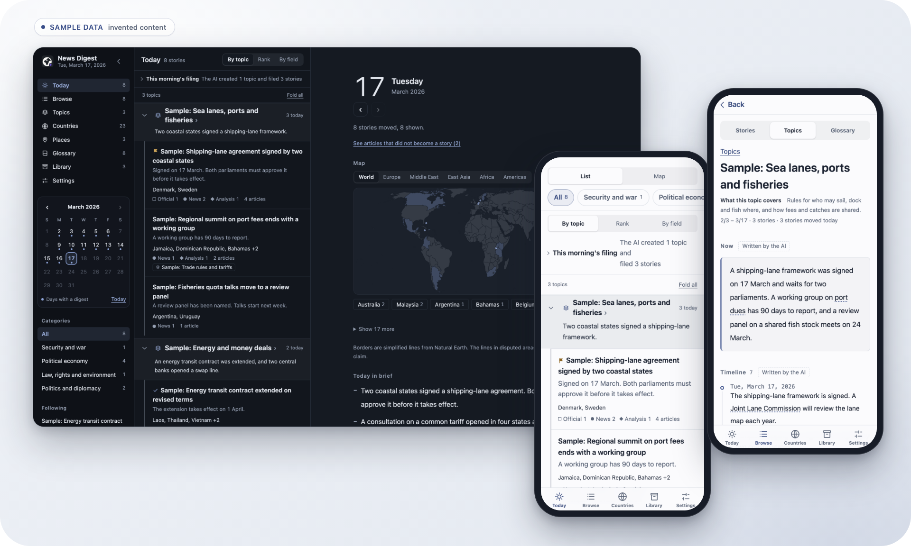

<p align="center">
  
</p>
<h1 align="center">News Digest</h1>
<p align="center">A personal morning digest of international politics and political economy news, grouped into continuing stories, readable on a phone or a desktop.</p>

<p align="center">
  
</p>

## What it does

- Groups each morning's articles into continuing stories, not a flat list of loose articles. A story has a short summary, where it stands now and what comes next, and it grows as new reports arrive.
- Keeps a timeline for every story: one line for each day something moved, with the number of articles behind it.
- Keeps every past day: a calendar marks the days that have a digest, and arrows step to the day before or after.
- Explains terms where they appear. A word that is in the glossary is underlined in summaries and timelines, and a small card with a short explanation opens on hover or tap.
- Shows where things happen: a world map shaded by the number of stories, a Countries view, and place tags for straits, seas and cities.
- Reads in English or Japanese, in light or dark mode, with three colour palettes, on a phone or a desktop.
- Lets you follow stories and save them in a Library. Each article is labelled official, news or analysis, so you can see who is saying what.

## How it works

```
GitHub Actions (each morning) ──► news feeds ──► Claude API (stories, summaries,
        │                                                    timelines, glossary, translations)
        ▼
    Firestore ◄──── this web app (static files on GitHub Pages, Firebase sign-in)
```

This repository holds only the page code (HTML, CSS and JavaScript). The processing scripts
and the data are kept private. Sign-in is by invitation only.

## Build your own

- **You need:** a GitHub account, a Firebase project (Firestore and Authentication), an
  Anthropic API key, and a list of news feeds that you are allowed to use.
- **Rough path:** (1) a script on your computer that collects the day's articles from the
  feeds, asks Claude to group them into stories and to write summaries, timelines and glossary
  entries, and saves the result; (2) a scheduled GitHub Actions job that runs it every morning
  and stores the results in Firestore; (3) a small web app that reads them after sign-in, with
  security rules so that only invited people can read.
- **Cost:** about 10 to 17 US dollars a month for the Claude API at this scale (an estimate;
  set a spending limit for each run). The Firebase and GitHub free tiers cover the rest.
- **Watch out for:**
  - Articles belong to their publishers. Keep only headlines, links and short excerpts, and
    keep them behind sign-in rather than on a public page.
  - Read each source's terms. Some do not allow use with AI or caching.
  - Keep API keys and service-account files out of the repository and out of folders that are
    synced to a cloud drive.
  - GitHub's scheduled runs can start late, sometimes by an hour or more.
- The shapes of the world map are simplified from [Natural Earth](https://www.naturalearthdata.com/) (public domain).
- Screenshots show invented sample data.
- This project was written with an AI coding assistant, [Claude Code](https://claude.com/claude-code).
